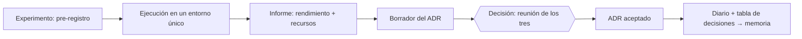

# Cómo trabajamos

Guía de trabajo del grupo para el proyecto TAPLN · TA1C. La seguimos los tres y se cambia solo con una PR aprobada por los otros dos.

> **Resumen en 30 segundos.** Hay 75 tareas numeradas en orden de ejecución. Cada una dice qué tareas deben estar terminadas antes de empezarla, y en el repo la tarea N es el issue #N. Los tres trabajamos en todas las áreas y el revisor va rotando. Se trabaja en una rama por tarea desde `develop`; la PR lleva `Closes #N`, la aprueba el revisor de la tarea y se fusiona con *squash*. Las decisiones de modelo o de arquitectura se toman con experimentos pre-registrados que miden rendimiento y recursos, en una reunión de los tres, y quedan en un ADR en `doc/adr/`. Todo lo que se prueba, se adopte o se descarte, se anota en `Diario_de_trabajo.md`.

Documentos relacionados: [lista de tareas y calendario](gestion/ROADMAP.md) · [protocolo de benchmarks](doc/benchmarks/PROTOCOLO.md) · [decisiones (ADR)](doc/adr/README.md) · [creación del tablero](gestion/README.md).

---

## 1. Equipo y reparto

| Miembro | GitHub |
|:--|:--|
| Guillermo | @GuillermoBlancoNunez · **portavoz** (lo exige el enunciado: es quien habla con el profesor) |
| Miguel | @MiguelBanosB |
| fizge | @fizge |

No hay más roles. Así se reparte el trabajo:

- **Todos trabajamos en todas las áreas.** T1, T2, plataforma y evaluación, y memoria se reparten entre los tres a partes casi iguales, y la carga de cada sprint está equilibrada. Las cifras están en [ROADMAP.md](gestion/ROADMAP.md#reparto).
- **Rotación en cadena.** Una tarea y la siguiente que depende de ella casi nunca las hace la misma persona. Así los tres acabamos conociendo cada parte del sistema, que es lo que se evalúa en la defensa.
- **Revisor rotatorio.** Cada tarea tiene su revisor (campo *Revisor*) y cambia de una tarea a otra: nadie tiene siempre el mismo revisor ni revisa siempre al mismo. Cuando se puede, revisa quien hará la tarea siguiente, para que llegue conociendo el código.
- **Decisiones entre los tres.** En las reuniones de decisión presenta quien hizo el experimento, y el ADR lo aprueban los otros dos.
- **El reparto se puede cambiar.** En el Planning se intercambian tareas libremente; basta con actualizar *Assignees* y *Revisor* en el tablero.

## 2. Ritmo de trabajo

| Sprint | Fechas | Tareas | Foco |
|:--|:--|:-:|:--|
| Sprint 1 · Cimientos | 26-oct → 08-nov | 01–18 | Repo y tablero, entorno, datos, medición, EDA, estado del arte, baselines, backend LLM |
| Sprint 2 · Componentes RAG | 09-nov → 22-nov | 19–34 | Capas LLM y de recuperación, métricas oficiales, elección de LLM y embeddings, pipelines v1 |
| Sprint 3 · Ajuste y decisiones | 23-nov → 06-dic | 35–57 | Benchmarks de T1 y T2, juez LLM, sistemas finales, borrador de la arquitectura |
| Sprint 4 · Evaluación final y entrega | 07-dic → 18-dic | 58–73 | Congelación, test (una sola vez), memoria y **entrega el 17-dic** (plazo: 18-dic 23:55) |
| Defensa | día del examen | 74–75 | Presentación y ensayos |

| Evento | Cuándo | Duración | Resultado |
|:--|:--|:-:|:--|
| **Sprint Planning** | Primer día del sprint | ≤45 min | Tareas del sprint en *Ready*, reparto confirmado y capacidad de cada uno; acta en el Diario |
| **Standup asíncrono** | Lunes, miércoles y viernes, en el chat del grupo | 2 min | Mensaje «Ayer / Hoy / Bloqueos» y tarjetas movidas en el tablero |
| **Seguimiento con el profesor** | Sesión de prácticas semanal | — | El portavoz presenta el tablero, los resultados y los bloqueos |
| **Reunión de decisión** | Cuando terminan sus experimentos | ≤45 min | ADR (se pueden agrupar varias decisiones en una sesión) |
| **Review + Retrospectiva** | Último día del sprint | 60–75 min | Demo, velocity, release `develop → main` con tag `v0.N` y mejoras al proceso |

Quién redacta el acta de cada reunión **va rotando**: es la persona en negrita de esa tarea.

**Capacidad.** De partida, unos 12 puntos por persona y sprint (1 punto ≈ 2 h). En la Review del Sprint 1 se recalibra con la *velocity* real. Si no llegamos, se recorta según el [orden de recorte](gestion/ROADMAP.md#orden-de-recorte-de-alcance); las tareas P0 no se recortan nunca.

## 3. Tareas numeradas y dependencias

- **El número es el orden.** En el plan, cada tarea solo depende de tareas con número menor, y en el repo la tarea N es el issue #N.
- **Cada issue indica:**
  - **⛔ Antes de empezar deben estar terminadas:** las tareas que tienen que estar en *Done*.
  - **➡️ Desbloquea:** las tareas que esperan a esta.
- **Regla:** no se pasa una tarea a *In progress* si alguna de las que requiere no está en *Done*. GitHub muestra esas tareas como *Blocked* (relación nativa *blocked by*).
- **Si hay que empezar antes** (por ejemplo, la EDA con pandas mientras se termina la capa de datos), se comenta en el issue y se acepta en el standup.
- **Tareas nuevas:** se crean con una plantilla y reciben el siguiente número libre, con el título `[NN] Descripción`. Si una tarea ya existente pasa a depender de una nueva, se añade la relación *blocked by* en GitHub; en ese caso el número ya no indica el orden.

## 4. Tablero

| Columna | Significa | Quién mueve la tarjeta |
|:--|:--|:--|
| **Backlog** | Planificada, pero no comprometida en este sprint | Los tres en el Planning |
| **Ready** | Cumple la Definition of Ready y entra en el sprint actual | Los tres en el Planning |
| **In progress** | Alguien trabaja en ella (máximo **2 por persona**) | Quien la hace, al empezar |
| **In review** | PR abierta esperando revisión | Automático al enlazar la PR, o quien la hace |
| **Done** | PR fusionada en `develop` y DoD cumplida | Automático al cerrar el issue |

- **Bloqueos externos** (cuota de GPU, un fallo de una librería…): label `estado:bloqueado`, comentario con el motivo y aviso en el standup.
- **Campos:** *Assignees* (el primero hace la tarea), *Revisor*, *Puntos*, milestone (= sprint), *Inicio* y *Fin*, y labels de tipo, área y prioridad.
- **Vistas:** Tablero, Sprint actual, Por persona, Decisiones (experimentos y decisiones), Épicas (con su progreso) y Roadmap.
- **Puntos (Fibonacci):** 1 ≈ 2 h · 2 ≈ medio día · 3 ≈ un día · 5 ≈ dos o tres días · 8 = mejor dividir.
- **Prioridad:** `prio:P0` *Must* (imprescindible) · `prio:P1` *Should* (recortable con justificación) · `prio:P2` *Could* (ampliación).

## 5. Definition of Ready

Una tarea solo pasa a *Ready* si:

- [ ] Tiene objetivo, criterios de aceptación verificables (sí/no) y épica.
- [ ] Tiene quién la hace, revisor, puntos (≤5; si son 8, se divide) y prioridad.
- [ ] Las tareas que requiere están en *Done* o se sabe cuándo lo estarán.
- [ ] Si es un experimento, el pre-registro está completo (ver [PROTOCOLO.md](doc/benchmarks/PROTOCOLO.md#3-pre-registro)).
- [ ] Los datos, el entorno y el cómputo que necesita están disponibles (p. ej. la cuota de GPU).

## 6. Definition of Done

Común a todas las tareas:

- [ ] Todos los criterios de aceptación marcados, y de verdad cumplidos.
- [ ] PR contra `develop` con `Closes #N`, aprobada por el revisor de la tarea (los ADR, por los otros dos) y con las conversaciones resueltas.
- [ ] CI en verde, con tests nuevos o actualizados si hay código.
- [ ] Reproducible: configuración en `configs/`, semilla fija y comando exacto en la descripción de la PR.
- [ ] Nada de `test_gold` (salvo en las tareas 61 y 62), ni datos, secretos o artefactos pesados en el diff.
- [ ] Entrada en `Diario_de_trabajo.md`: qué se hizo o probó, por qué, la fuente y el estado (**Adoptado / Descartado / Pendiente**).
- [ ] README o documentación actualizados si cambia cómo se usa algo.

Además, según el tipo de tarea:

| Tipo | Requisitos extra |
|:--|:--|
| Experimento | Resultados en `results/NN/` con el esquema común (rendimiento, recursos y hardware), resumen en el issue y borrador del ADR |
| Decisión | ADR en estado *Aceptado*, fila en `doc/adr/README.md` y tareas bloqueadas actualizadas |
| Memoria | Cada cifra es trazable a un fichero de `results/`; las referencias están en `referencias.bib` |
| Ceremonia | Acta en el Diario y tablero al día |

## 7. Flujo de Git

```
main      ← releases: develop → main al final de cada sprint (tag v0.N) y v1.0 para la entrega
develop   ← integración: aquí llegan todas las PRs
<tipo>/<NN>-<slug>  ← una rama por tarea, creada desde develop
```

- **Nombre de rama:** `feat/31-rag-t1`, `exp/23-embeddings`, `docs/46-arquitectura`, `fix/11-ids-duplicados`, `dec/33-llm`.
- **Crear la rama desde el issue** (queda enlazada automáticamente):
  `gh issue develop 31 --base develop --name feat/31-rag-t1 --checkout`
- **Commits:** [Conventional Commits](https://www.conventionalcommits.org/es/v1.0.0/) en español, con el área como ámbito: `feat(t1): …`, `fix(data): …`, `docs(adr): …`, `test(eval): …`, `exp(t2): …` (scripts, configuraciones y resultados de experimentos), `chore`, `build`, `ci`, `refactor`, `perf`.
- **PRs pequeñas:** una por tarea, o varias si es grande, y menos de 400 líneas de diff salvo resultados o notebooks. Conviene abrirlas pronto como *draft* para recibir comentarios.
- **Título de la PR:** `[NN] Descripción`. Se usa la plantilla y se pone `Closes #NN` en la descripción.
- **Antes de pedir revisión:** actualizar la rama (`git fetch && git rebase origin/develop`, o un merge) y pasar los checks en local.
- **Fusión:** *Squash and merge* hacia `develop`, con el título de la PR como mensaje. Las releases `develop → main` se fusionan con *merge commit* y se etiquetan.
- **Prohibido:** hacer push directo a `main` o `develop`, hacer force-push sobre ramas de otros y versionar CSV, modelos, índices o secretos.

## 8. Revisión de código

- **Quién revisa:** el del campo *Revisor* de la tarea. CODEOWNERS pide revisión a los otros dos en cada PR; la aprobación la da el revisor asignado y el otro opina si puede. Si el revisor asignado no puede en plazo, revisa el otro y se apunta en la PR.
- **Plazos:** primera revisión en **≤24 h** si la tarea está en la [ruta crítica](gestion/ROADMAP.md#ruta-crítica) y en **≤48 h** en el resto (días lectivos).
- **Qué comprueba el revisor:**
  - [ ] Hace lo que pide la tarea y cumple sus criterios de aceptación.
  - [ ] **No hay fuga de datos:** el split es el correcto, `test_gold` no se toca y la base de conocimiento del RAG solo contiene train.
  - [ ] Las métricas usan la configuración oficial (tarea 21) y los recursos se miden con el harness (tarea 12).
  - [ ] Es reproducible: ha ejecutado el comando de la PR o ha revisado los logs y `results/`.
  - [ ] Tiene tests razonables y un código legible (nombres, tipos, sin código muerto).
  - [ ] La entrada del Diario y la documentación están al día.
- **Comentarios con prefijo:** `[bloqueante]` (implica *Request changes*), `[sugerencia]`, `[pregunta]` y `[nit]` (detalle menor, no bloquea).
- **Cierre:** quien hizo la tarea responde y resuelve los comentarios, el revisor aprueba y **la fusiona quien la hizo**.
- **Desacuerdos:** (1) se discuten en la PR con datos; (2) si en 24 h no hay acuerdo, se llevan al standup; (3) las cuestiones técnicas las decide la evidencia (un mini-benchmark) y, si sigue habiendo dudas, se decide por mayoría (2 de 3).
- **Notebooks:** la lógica va en `src/` y los notebooks solo exploran o presentan. Se versionan sin salidas pesadas.

## 9. Experimentos y decisiones de arquitectura

Toda elección de modelo o de componente (backend, LLM, embeddings, índice, chunking, recuperación, generación, juez…) sigue este ciclo:



1. **Pre-registro (antes de ejecutar):** hipótesis, ≥3 candidatos (o una justificación) más un baseline sencillo, métricas de rendimiento y de recursos, criterio de decisión y entorno. Los criterios no se cambian a la vista de los resultados; si hay que cambiarlos, se documenta el motivo.
2. **Ejecución:** todas las opciones en el mismo entorno, sobre dev y con el harness común.
3. **Informe:** tabla con rendimiento (IC95) y recursos (tiempo, latencia p50/p95, RAM/VRAM, energía), gráfico calidad vs. coste y borrador del ADR.
4. **Reunión de decisión (≤45 min):** presenta quien hizo el experimento y se aplica el criterio. Se decide por consenso y, si no lo hay, por votación 2 de 3; las discrepancias quedan en el ADR.
5. **ADR aceptado:** el ADR se aprueba en PR, se añade una fila en [doc/adr/README.md](doc/adr/README.md) y se desbloquean las tareas afectadas. Esa tabla es la base del capítulo de decisiones de la memoria (tarea 67).

Detalle de métricas, medición de energía, estadística y formato de resultados: [doc/benchmarks/PROTOCOLO.md](doc/benchmarks/PROTOCOLO.md).

## 10. Diario de Trabajo

El Diario es un apartado obligatorio de la memoria y cuenta mucho en la evaluación.

- Se sigue el formato actual: `## AAAA-MM-DD · Tema` y viñetas con la decisión o técnica, el motivo, la fuente con enlace y el estado **Adoptado / Descartado / Pendiente**.
- **Cada PR que pruebe, adopte o descarte algo añade su entrada en esa misma PR.** No se deja para el final.
- También van al Diario las actas de Planning, Review y Retro (con la velocity) y las reuniones de decisión (enlazando el ADR).
- Si hay conflictos de merge en el Diario, se conservan las dos entradas y se ordenan por fecha.

## 11. Estructura del repositorio

La estructura objetivo la crea la tarea 04; si cambia, se actualiza este apartado.

```
src/tapln/
  data/        carga, validación y guardarraíl de test
  retrieval/   embeddings, índices, BM25, híbrido
  llm/         cliente LLM, caché, prompts, salida estructurada
  bench/       harness de medición de recursos
  eval/        métricas oficiales, estadística, juez LLM
  t1/          detección: baselines, RAG few-shot, sistema final
  t2/          spoiling: extracción, chunking, generación, sistema final
configs/       YAML de cada experimento y de los sistemas finales
prompts/       prompts versionados (id + versión)
scripts/       utilidades de línea de comandos
tests/         pytest (lo que es lento va marcado con @pytest.mark.slow)
notebooks/     EDA y runner de Colab/Kaggle
results/       un JSON por ejecución en results/NN/ + resúmenes
doc/           memoria, ADR, protocolo de benchmarks, figuras
gestion/       backlog (línea base), roadmap y script del tablero
```

## 12. Datos, test y reproducibilidad

- **`test_gold` solo se usa en las tareas 61 y 62,** con `--final-test`, una única vez y después de congelar la arquitectura (tarea 60). La capa de datos lo impone en el código.
- La base de conocimiento del RAG y los ejemplos few-shot salen **solo de train**.
- Semillas fijas, configuraciones versionadas, hash del prompt y commit registrados en cada resultado.
- Los modelos y checkpoints se guardan fuera de git (Drive o HF Hub privado). Los JSON de resultados pequeños sí se versionan.
- Los secretos van en `.env` (no versionado). En `.env.example` solo figuran los nombres de las variables.

## 13. Comandos útiles

```bash
gh issue list --assignee @me --milestone "Sprint 1 · Cimientos"      # mis tareas del sprint
gh issue view 31                                                     # requisitos y criterios de la tarea 31
gh issue develop 31 --base develop --name feat/31-rag-t1 --checkout  # rama enlazada a la tarea
gh pr create --base develop --draft --fill                           # añade «Closes #31» en la descripción
gh pr checks                                                         # estado de la CI
gh pr review 80 --approve            # o: --request-changes -b "[bloqueante] …"
gh pr merge 80 --squash --delete-branch
uv run --with pyyaml python gestion/bootstrap_github.py report -o gestion/ROADMAP.md
```
