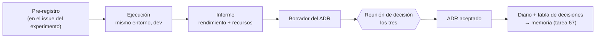

# Protocolo de benchmarks y decisiones

Cada decisión de modelo o de arquitectura del proyecto (9 decisiones, ADR-001 a ADR-009) se toma con evidencia medida siempre de la misma forma, para que las opciones sean comparables y los resultados puedan pasar sin retoques a la memoria. Este protocolo es de obligado cumplimiento en todas las tareas de tipo experimento, y el harness de la tarea 12 lo implementa.

## 1. Alcance

| Decisión (tarea) | ADR | Pregunta | Experimentos (tareas) |
|:-:|:--|:--|:--|
| 17 | ADR-001 | ¿Con qué backend servimos los LLMs en CPU y en GPU? | 15 |
| 28 | ADR-002 | ¿Qué embeddings e índice usamos? | 23, 24 |
| 33 | ADR-003 | ¿Qué LLM genera en T1 y T2? | 29, 30 |
| 43 | ADR-004 | ¿Cómo dividimos y recuperamos los pasajes en T2? | 37, 40 |
| 49 | ADR-005 | ¿Cuál es el enfoque final de T1? | 25, 42 (+ 48) |
| 51 | ADR-006 | ¿Qué juez LLM es fiable frente a la anotación humana? | 45 |
| 53 | ADR-007 | ¿Qué contexto y qué estrategia de generación usa T2? | 50 |
| 54 | ADR-008 | ¿Qué ampliaciones entran en el sistema final? | 39, 41, 44, 48 |
| 60 | ADR-009 | Congelación de la arquitectura final | 52, 55 |

## 2. Ciclo de una decisión



## 3. Pre-registro

Se rellena en el issue del experimento **antes** de ejecutar nada y queda fijado.

| Campo | Contenido mínimo |
|:--|:--|
| Hipótesis | Qué se espera y por qué (con una fuente si existe) |
| Candidatos | ≥3 opciones (o una justificación de por qué menos) **y un baseline sencillo** |
| Rendimiento | Métrica principal y secundarias (ver §4) |
| Recursos | Las obligatorias de §5 y las específicas que apliquen |
| Criterio de decisión | Restricciones duras (p. ej. VRAM ≤ 15 GB para caber en una T4), métrica principal y desempate por coste |
| Entorno | Plataforma y hardware en los que se mide todo (ver §6) |
| Presupuesto | Tiempo o cuota de GPU máximos; si se supera, se recorta el número de candidatos |

Si a la vista de los resultados hay que cambiar algo, se anota en el informe como **desviación del pre-registro**, con su motivo. Nunca se cambia en silencio.

## 4. Métricas de rendimiento

Todas se calculan sobre **dev**. `test_gold` solo se usa en las tareas 61 y 62.

| Ámbito | Principal | Secundarias |
|:--|:--|:--|
| T1 · Detección | macro-F1 (métrica oficial) | P, R y F1 por clase; matriz de confusión; % de salidas no parseables |
| T2 · Spoiling | ROUGE-L, BERTScore-F1 y BLEU-4 con la configuración oficial (tarea 21) | % de salidas de ≤280 caracteres; puntuación del juez (ADR-006); tasa de alucinación |
| Recuperación | Recall@3 sobre las silver labels (tarea 22) | Recall@1/5, MRR, nDCG@5 |
| Juez LLM | Spearman con la media humana (tarea 38) | Kendall τ, κ en aprobado/suspenso, sesgos de posición y de longitud |

**Incertidumbre y significancia**

- **IC95 por bootstrap** en todas las métricas: ≥1000 remuestreos con semilla fija, sobre los ejemplos de dev.
- **Comparación de dos opciones** sobre los mismos ejemplos: test de McNemar en T1 y bootstrap pareado o permutación aproximada en T2 (Koehn, 2004; Dror et al., 2018), con α = 0,05.
- **Entrenamiento o generación estocásticos:** ≥3 semillas, reportando media ± desviación.
- **Comparaciones múltiples:** con muchas configuraciones sobre 100 ejemplos (T2), las diferencias pequeñas son ruido. Dev sirve para elegir; las afirmaciones finales se hacen con test, una sola vez.

## 5. Métricas de recursos (obligatorias)

| Métrica | Definición | Unidad | Cómo se mide |
|:--|:--|:--|:--|
| Tiempo de carga | Cargar el modelo o construir el índice | s | `time.perf_counter()` |
| Tiempo total | Procesar el split completo | s | `time.perf_counter()` |
| Latencia | Por muestra, tras 3 peticiones de calentamiento | ms (p50/p95/p99) | `perf_counter`; en GPU, `torch.cuda.synchronize()` antes de cada medida |
| Throughput | Muestras por segundo; en LLMs, tokens/s de prefill y de generación | muestras/s, tokens/s | Contadores del harness |
| Tokens | Entrada y salida, totales y por muestra | tokens | Tokenizador del modelo o respuesta del backend |
| RAM pico | RSS del proceso y sus hijos | MB | `psutil`, muestreo a 10 Hz |
| VRAM pico | Memoria de GPU ocupada | MB | `torch.cuda.max_memory_allocated()` o NVML (pynvml) para backends no PyTorch |
| Energía | Consumo de CPU, GPU y RAM durante la ejecución | kWh (y kWh/1000 muestras) | CodeCarbon `EmissionsTracker`, `measure_power_secs=1` |
| Emisiones | CO₂ equivalente | kg CO₂eq | CodeCarbon (`country_iso_code="ESP"` en local; región del proveedor en Colab/Kaggle) |
| Entrenamiento | Tiempo y energía (si se entrena) | s, kWh | Igual que arriba |
| Tamaño | Parámetros, cuantización y disco | M parámetros, GB | Ficha del modelo, `du` |
| Coste | Coste económico | € | 0 en local; con APIs gratuitas, tokens y cuota |

**Método de energía (hay que declararlo siempre).** La GPU se mide por NVML, con precisión razonable. La CPU se mide por RAPL en Linux sin virtualizar; en Windows y en las VMs de Colab/Kaggle CodeCarbon estima a partir del TDP. La RAM es siempre una estimación. Cada resultado guarda el método (`nvml`, `rapl` o `tdp`), y en la memoria se citan como limitaciones las cifras estimadas.

## 6. Entorno y comparación justa

- **Mismo entorno para todas las opciones de una decisión.** Se registra la plataforma (local/Colab/Kaggle), el modelo de CPU, núcleos, RAM, GPU y VRAM, el SO, el driver/CUDA, el commit y el hash de `uv.lock`.
- **Mismo protocolo:** mismo split, mismo prompt (salvo que sea la variable estudiada), decodificación determinista (temperature 0, mismo `max_tokens`) y misma política de *batching*.
- **Portátil:** enchufado a la corriente (en batería la CPU baja de frecuencia), con el modo de rendimiento activado y sin aplicaciones pesadas abiertas.
- **Colab/Kaggle:** se anota la GPU asignada. Si cambia a mitad de un experimento, se repiten todas las opciones en el mismo tipo de GPU.
- **Caché de respuestas (tarea 27) desactivada** al medir tiempos y energía; si no, se miden aciertos de caché en vez de inferencias.
- **Repeticiones:** p50/p95 sobre todas las muestras de una ejecución y, además, 3 ejecuciones sobre un subconjunto (p. ej. 100 muestras) para estimar la variación entre ejecuciones.

## 7. Formato de resultados

Cada ejecución guarda un JSON en `results/NN/<run_id>.json` (NN = número de la tarea) que valida contra `results/schema.json` (tarea 12). Ejemplo con **valores ficticios**:

```json
{
  "schema_version": "1.0",
  "id": "29",
  "run_id": "2026-11-15T10-32-05_modelo-x-q4",
  "option": "modelo-x-7b-instruct-q4_k_m",
  "task": "T1",
  "split": "dev",
  "seed": 1234,
  "git_commit": "abc1234",
  "uv_lock_sha256": "…",
  "prompt": {"id": "t1_zero_shot", "version": 2, "sha256": "…"},
  "config": {"backend": "…", "temperature": 0, "max_tokens": 8},
  "metrics": {
    "macro_f1": 0.0, "macro_f1_ci95": [0.0, 0.0],
    "f1_clickbait": 0.0, "f1_no": 0.0, "invalid_output_rate": 0.0
  },
  "resources": {
    "load_time_s": 0.0, "wall_time_s": 0.0,
    "latency_ms": {"p50": 0.0, "p95": 0.0, "p99": 0.0},
    "throughput_per_s": 0.0, "tokens_in": 0, "tokens_out": 0,
    "tokens_per_s_prefill": 0.0, "tokens_per_s_gen": 0.0,
    "peak_ram_mb": 0, "peak_vram_mb": 0,
    "energy_kwh": 0.0, "energy_kwh_per_1000": 0.0, "co2_kg": 0.0, "energy_method": "nvml+tdp"
  },
  "hardware": {"platform": "kaggle", "cpu": "…", "cores": 4, "ram_gb": 0.0, "gpu": "Tesla T4", "vram_gb": 15.0, "os": "Linux"},
  "versions": {"python": "3.13.x", "torch": "…", "transformers": "…"},
  "timestamp": "2026-11-15T10:45:12+01:00"
}
```

- `tapln results summarize <NN>` (tarea 20) genera `results/NN/summary.md` (tabla con IC95) y `results/NN/pareto.png` (calidad frente a latencia y energía).
- Los JSON y las predicciones pequeñas (<1 MB) se versionan. Modelos, índices y cachés quedan fuera de git.

## 8. Cómo se decide

1. Se **descartan** las opciones que incumplen alguna restricción dura (VRAM, latencia, licencia, compatibilidad con Windows o Colab).
2. Se compara la **métrica principal** con su IC95.
3. Si la diferencia **no es significativa** (IC95 solapados o test pareado con p ≥ 0,05), gana la opción **más barata** según el desempate pre-registrado (energía, latencia o tokens).
4. Los factores cualitativos (licencia, mantenimiento, complejidad o riesgo) se discuten y quedan escritos en el ADR.
5. El **frente de Pareto** (calidad frente a coste) se incluye siempre en el ADR: deja ver lo que se gana y lo que se paga con cada opción.
6. Se decide **por consenso** y, si no lo hay, por votación 2 de 3. Las discrepancias se registran en el ADR.

## 9. Paso a la memoria

- Cada ADR aceptado añade una fila a la tabla de [doc/adr/README.md](../adr/README.md): opción elegida, alternativas, evidencia de rendimiento y de recursos, y motivo. Esa tabla es el núcleo del capítulo de decisiones y eficiencia (tarea 67).
- La tarea 63 agrega todos los resultados: frente de Pareto global y huella total del proyecto (kWh y kgCO₂eq).
- **Limitaciones que hay que declarar:** la energía de CPU estimada por TDP, la variabilidad del hardware compartido (Colab/Kaggle), el tamaño de dev en T2 (n = 100) y las limitaciones de las métricas basadas en n-gramas.

## 10. Referencias

- Henderson, P. et al. (2020). *Towards the Systematic Reporting of the Energy and Carbon Footprints of Machine Learning*. JMLR 21(248).
- Strubell, E., Ganesh, A. y McCallum, A. (2019). *Energy and Policy Considerations for Deep Learning in NLP*. ACL 2019.
- Dror, R. et al. (2018). *The Hitchhiker's Guide to Testing Statistical Significance in Natural Language Processing*. ACL 2018.
- Koehn, P. (2004). *Statistical Significance Tests for Machine Translation Evaluation*. EMNLP 2004.
- Efron, B. y Tibshirani, R. (1993). *An Introduction to the Bootstrap*. Chapman & Hall.
- Gu, J. et al. (2025). *A Survey on LLM-as-a-Judge*. arXiv:2411.15594.
- CodeCarbon: <https://mlco2.github.io/codecarbon/>
- Nygard, M. (2011). *Documenting Architecture Decisions*. <https://cognitect.com/blog/2011/11/15/documenting-architecture-decisions>
