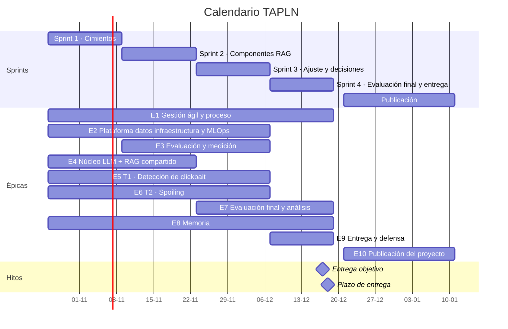
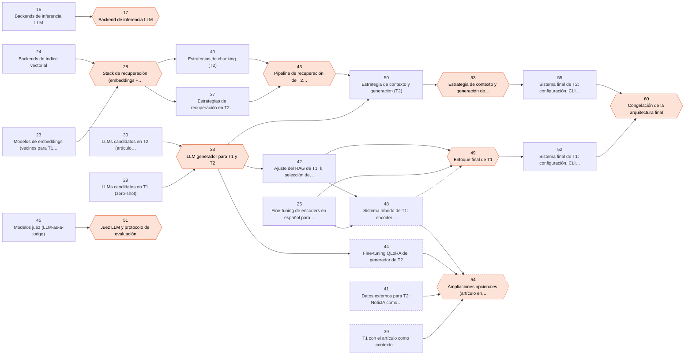

# Roadmap del proyecto · TAPLN (TA1C)

> Generado con `uv run --with pyyaml python gestion/bootstrap_github.py report -o gestion/ROADMAP.md`. No editar a mano: se cambia `gestion/backlog.yml` y se regenera. Es la **línea base** del plan; el estado vivo está en el GitHub Project.

**Entrega:** 2026-12-18 23:55 (Europe/Madrid) · **Objetivo interno:** 2026-12-17 · **Alcance:** 79 tareas · 140 pts P0 + 23 pts P1 + 17 pts P2 (ampliaciones).

## Cómo leer este plan

- **Tareas numeradas en orden de ejecución.** Una tarea solo puede empezar cuando están terminadas las de su columna *Requiere*, que siempre tienen un número menor. En el repo, la tarea N es el issue #N.
- **Numeración en GitHub.** Las tareas 76–79 se añadieron después del bootstrap. En GitHub van detrás de las épicas (#76–#84): la tarea 76 es el issue #85, la 79 el #88 y la épica E10 el #89, si no se crea ningún otro issue o PR antes de relanzar `apply`. El título de cada issue lleva siempre su número de tarea [NN].
- **Reparto rotatorio.** Los tres trabajan en todas las áreas (T1, T2, plataforma y evaluación, memoria) y la carga por sprint está equilibrada. Las decisiones se toman entre los tres.
- **Revisiones rotatorias.** El revisor cambia de una tarea a otra, y cada uno revisa a los otros dos más o menos lo mismo. Cuando se puede, revisa quien hará la tarea siguiente que depende de esa, para que llegue conociendo el código.
- **Portavoz** (lo exige el enunciado): @GuillermoBlancoNunez.

## Calendario

| Sprint | Fechas | Tareas | Objetivo | Puntos P0+P1 |
|:--|:--|:-:|:--|:-:|
| **Sprint 1 · Cimientos** | 26-oct → 08-nov | 01–18 | Entorno, datos y medición listos; EDA y estado del arte de ambas tareas; baselines clásicos de T1; decisión del backend de inferencia (ADR-001). | 38 |
| **Sprint 2 · Componentes RAG** | 09-nov → 22-nov | 19–34 | Capas LLM y de recuperación; métricas oficiales; benchmarks de LLMs y embeddings (ADR-002, ADR-003); pipelines LLM + RAG v1 de T1 y T2; baselines de T2. | 38 |
| **Sprint 3 · Ajuste y decisiones** | 23-nov → 06-dic | 35–57 | Benchmarks del enfoque de T1, de la recuperación y la generación de T2 y del juez LLM (ADR-004 a ADR-007); sistemas finales de T1 y T2; borrador de la arquitectura. | 38 |
| **Sprint 4 · Evaluación final y entrega** | 07-dic → 18-dic | 58–73 | Congelación (ADR-009), evaluación única en test, ablaciones y eficiencia, memoria completa y entrega el 17-dic (plazo: 18-dic 23:55). | 34 |
| **Defensa** | 19-dic → fecha del examen | 74–75 | Presentación y ensayos para la defensa del día del examen. | 5 |
| **Publicación** | 21-dic → 10-ene | 76–79 | Tras la entrega y sin competir con ella: API de inferencia en Docker, encoder en Hugging Face Hub, README bilingüe y auditoría antes de hacer público el repo. | 10 |

## Reparto

**Carga por sprint** (puntos P0+P1; las tareas compartidas se reparten a partes iguales; entre paréntesis, las ampliaciones P2). Capacidad de referencia: **12 pts/persona/sprint** (1 pt ≈ 2 h).

| Sprint | Guillermo | Miguel | fizge | Total |
|:--|:-:|:-:|:-:|:-:|
| S1 | 12.7 | 12.7 | 12.7 | 38.0 |
| S2 | 12.7 | 12.7 | 12.7 | 38.0 |
| S3 | 13.3 (+6.3) | 13.3 (+5.3) | 11.3 (+5.3) | 38.0 |
| S4 | 11.7 | 11.7 | 10.7 | 34.0 |
| DEF | 0.7 | 0.7 | 3.7 | 5.0 |
| PUB | 4.0 | 3.0 | 3.0 | 10.0 |
| **Total** | **55.0** | **54.0** | **54.0** | **163.0** |

**Todos en todas las áreas** (puntos de tareas individuales, incluidas las P2):

| Área | Guillermo | Miguel | fizge |
|:--|:-:|:-:|:-:|
| gestión | 3 | 0 | 3 |
| común | 13 | 16 | 13 |
| T1 | 10 | 10 | 10 |
| T2 | 14 | 14 | 14 |
| memoria | 11 | 9 | 9 |

**Quién revisa a quién** (nº de PRs que aprueba cada revisor de cada autor; los ADR los aprueban los otros dos):

| Revisor ↓ · Autor → | Guillermo | Miguel | fizge | Total |
|:--|:-:|:-:|:-:|:-:|
| Guillermo | — | 15 | 15 | 30 |
| Miguel | 17 | — | 13 | 30 |
| fizge | 17 | 14 | — | 31 |

## Lista de tareas

*Requiere* = tareas que deben estar **terminadas** antes de empezar. *Desbloquea* = tareas que esperan a esta. En las compartidas, el nombre en negrita abre la PR o redacta el acta.

### Sprint 1 · Cimientos (26-oct → 08-nov)

_Entorno, datos y medición listos; EDA y estado del arte de ambas tareas; baselines clásicos de T1; decisión del backend de inferencia (ADR-001)._

| Nº | Tarea | La hace | La revisa | Pts | Prio | Requiere | Desbloquea |
|:-:|:--|:--|:--|:-:|:-:|:--|:--|
| **01** | Completar la configuración del repo y del tablero | Guillermo | Miguel | 3 | P0 | — | — |
| **02** | Revisar entre los tres el proceso, el plan y el reparto | Los tres (**Guillermo**) | Miguel, fizge | 1 | P0 | — | — |
| **03** | Sprint 1 · Planning | Los tres (**Guillermo**) | fizge | 1 | P0 | — | — |
| **04** | Estructura del repositorio y paquete `tapln` | Guillermo | Miguel | 2 | P0 | — | 10, 11, 12, 13, 14 |
| **05** | EDA de detección (train y dev) | Miguel | fizge | 2 | P0 | — | — |
| **06** | Estado del arte de T1 | Miguel | Guillermo | 2 | P0 | — | — |
| **07** | EDA de spoiling (train y dev) | fizge | Guillermo | 2 | P0 | — | — |
| **08** | Estado del arte de T2 | Miguel | Guillermo | 2 | P0 | — | — |
| **09** | Plantilla, estructura y portada de la memoria | fizge | Miguel | 2 | P0 | — | — |
| **10** | Calidad de código y CI: ruff, pytest, pre-commit y GitHub Actions | fizge | Guillermo | 2 | P0 | 04 | — |
| **11** | Capa de datos: carga, validación y guardarraíl anti-fuga de test | Guillermo | fizge | 3 | P0 | 04 | 16, 21, 22, 23, 29 |
| **12** | Harness de medición de recursos y esquema de resultados | fizge | Guillermo | 3 | P0 | 04 | 14, 15, 16, 20, 23, 27 |
| **13** | Runner reproducible para Colab y Kaggle | Miguel | fizge | 2 | P0 | 04 | 15, 25 |
| **14** | Capa de recuperación: embeddings, índice vectorial, BM25 e híbrido | Miguel | Guillermo | 3 | P0 | 04, 12 | 24, 31, 32, 37 |
| **15** | Benchmark de backends de inferencia LLM | Guillermo | Miguel | 3 | P0 | 12, 13 | 17 |
| **16** | Baselines clásicos de T1 (mayoritaria, TF-IDF + LR/SVM) | fizge | Miguel | 2 | P0 | 11, 12 | — |
| **17** | Decisión: backend de inferencia LLM | Los tres (**Guillermo**) | Miguel, fizge | 1 | P0 | 15 | 27 |
| **18** | Sprint 1 · Review y retrospectiva | Los tres (**Miguel**) | fizge | 2 | P0 | — | 19 |

### Sprint 2 · Componentes RAG (09-nov → 22-nov)

_Capas LLM y de recuperación; métricas oficiales; benchmarks de LLMs y embeddings (ADR-002, ADR-003); pipelines LLM + RAG v1 de T1 y T2; baselines de T2._

| Nº | Tarea | La hace | La revisa | Pts | Prio | Requiere | Desbloquea |
|:-:|:--|:--|:--|:-:|:-:|:--|:--|
| **19** | Sprint 2 · Planning | Los tres (**fizge**) | Guillermo | 1 | P0 | 18 | — |
| **20** | Agregación de resultados y herramienta de tracking de experimentos | Guillermo | fizge | 2 | P1 | 12 | — |
| **21** | Métricas oficiales de TA1C e intervalos de confianza | fizge | Guillermo | 3 | P0 | 11 | 25, 26, 30, 36 |
| **22** | Extracción de artículos y silver labels de relevancia | fizge | Miguel | 3 | P0 | 11 | 23, 26, 30, 32, 37 |
| **23** | Benchmark de modelos de embeddings (vecinos para T1, pasajes para T2) | Miguel | Guillermo | 3 | P0 | 11, 12, 22 | 28 |
| **24** | Benchmark de backends de índice vectorial | fizge | Miguel | 2 | P1 | 14 | 28 |
| **25** | Fine-tuning de encoders en español para T1 (baseline fuerte) | Guillermo | Miguel | 3 | P0 | 13, 21 | 48, 49, 77 |
| **26** | Baselines de T2 sin LLM (lead, subtítulo, frase más similar, oráculo) | Miguel | fizge | 2 | P0 | 21, 22 | 38 |
| **27** | Capa LLM: cliente unificado, caché, prompts versionados y salida estructurada | Miguel | Guillermo | 3 | P0 | 12, 17 | 29, 30, 31, 32, 45 |
| **28** | Decisión: stack de recuperación (embeddings + índice) | Los tres (**Miguel**) | Guillermo, fizge | 1 | P0 | 23, 24 | 37, 40, 46, 47 |
| **29** | Benchmark de LLMs candidatos en T1 (zero-shot) | fizge | Guillermo | 3 | P0 | 11, 27 | 33 |
| **30** | Benchmark de LLMs candidatos en T2 (artículo completo, zero-shot) | Guillermo | fizge | 3 | P0 | 21, 22, 27 | 33, 38 |
| **31** | Pipeline T1 LLM + RAG (few-shot dinámico) v1 | Miguel | fizge | 3 | P0 | 14, 27 | 39, 42 |
| **32** | Pipeline T2 LLM + RAG v1 | Guillermo | Miguel | 3 | P0 | 14, 22, 27 | 40, 41, 44, 50 |
| **33** | Decisión: LLM generador para T1 y T2 | Los tres (**fizge**) | Guillermo, Miguel | 1 | P0 | 29, 30 | 42, 44, 46, 47, 50 |
| **34** | Sprint 2 · Review y retrospectiva | Los tres (**Guillermo**) | fizge | 2 | P0 | — | 35 |

### Sprint 3 · Ajuste y decisiones (23-nov → 06-dic)

_Benchmarks del enfoque de T1, de la recuperación y la generación de T2 y del juez LLM (ADR-004 a ADR-007); sistemas finales de T1 y T2; borrador de la arquitectura._

| Nº | Tarea | La hace | La revisa | Pts | Prio | Requiere | Desbloquea |
|:-:|:--|:--|:--|:-:|:-:|:--|:--|
| **35** | Sprint 3 · Planning | Los tres (**Miguel**) | Guillermo | 1 | P0 | 34 | — |
| **36** | Tests de significancia pareados (McNemar y bootstrap pareado) | Miguel | fizge | 2 | P1 | 21 | — |
| **37** | Benchmark de estrategias de recuperación en T2 (denso, BM25, híbrido, reranker) | Guillermo | Miguel | 3 | P0 | 14, 22, 28 | 43 |
| **38** | LLM-as-a-judge: rúbrica y anotación humana de referencia | Los tres (**fizge**) | Miguel | 3 | P1 | 26, 30 | 45 |
| **39** | T1 con el artículo como contexto (deteccion_extra, solo dev) | Guillermo | fizge | 3 | P2 | 31 | 54 |
| **40** | Benchmark de estrategias de chunking (T2) | fizge | Guillermo | 3 | P0 | 28, 32 | 43 |
| **41** | Datos externos para T2: NoticIA como pool few-shot | fizge | Guillermo | 3 | P2 | 32 | 54 |
| **42** | Ajuste del RAG de T1: k, selección de ejemplos y prompt | Miguel | Guillermo | 3 | P0 | 31, 33 | 48, 49 |
| **43** | Decisión: pipeline de recuperación de T2 (chunking + retrieval + reranking) | Los tres (**fizge**) | Guillermo, Miguel | 1 | P0 | 37, 40 | 50 |
| **44** | Fine-tuning QLoRA del generador de T2 | Miguel | Guillermo | 5 | P2 | 32, 33 | 54 |
| **45** | Benchmark de modelos juez (LLM-as-a-judge) | fizge | Miguel | 3 | P1 | 27, 38 | 51 |
| **46** | Capítulo de arquitectura del sistema (módulos, funciones, interacciones, E/S) | Guillermo | Miguel | 3 | P0 | 28, 33 | 69 |
| **47** | Herramientas de terceros y licencias | fizge | Miguel | 2 | P0 | 28, 33 | 69, 77 |
| **48** | Sistema híbrido de T1: encoder fine-tuneado + LLM-RAG | fizge | Guillermo | 2 | P2 | 25, 42 | 54 |
| **49** | Decisión: enfoque final de T1 | Los tres (**Guillermo**) | Miguel, fizge | 1 | P0 | 25, 42 | 52 |
| **50** | Benchmark de estrategia de contexto y generación (T2) | Miguel | fizge | 5 | P0 | 32, 33, 43 | 53 |
| **51** | Decisión: juez LLM y protocolo de evaluación | Los tres (**fizge**) | Guillermo, Miguel | 1 | P1 | 45 | — |
| **52** | Sistema final de T1: configuración, CLI y ficha del sistema | Guillermo | fizge | 2 | P0 | 49 | 56, 60, 76 |
| **53** | Decisión: estrategia de contexto y generación de T2 | Los tres (**Miguel**) | Guillermo, fizge | 1 | P0 | 50 | 55 |
| **54** | Decisión: ampliaciones opcionales (artículo en T1, NoticIA, QLoRA, híbrido) | Los tres (**Guillermo**) | Miguel, fizge | 1 | P2 | 39, 41, 44, 48 | — |
| **55** | Sistema final de T2: configuración, CLI y ficha del sistema | Guillermo | fizge | 2 | P0 | 53 | 56, 60, 76 |
| **56** | Demo integrada T1 → T2 | Guillermo | Miguel | 3 | P2 | 52, 55 | — |
| **57** | Sprint 3 · Review y retrospectiva | Los tres (**fizge**) | Miguel | 2 | P0 | — | 58 |

### Sprint 4 · Evaluación final y entrega (07-dic → 18-dic)

_Congelación (ADR-009), evaluación única en test, ablaciones y eficiencia, memoria completa y entrega el 17-dic (plazo: 18-dic 23:55)._

| Nº | Tarea | La hace | La revisa | Pts | Prio | Requiere | Desbloquea |
|:-:|:--|:--|:--|:-:|:-:|:--|:--|
| **58** | Sprint 4 · Planning | Los tres (**Guillermo**) | Miguel | 1 | P0 | 57 | — |
| **59** | Diario de Trabajo consolidado para la memoria | fizge | Miguel | 2 | P0 | — | 69 |
| **60** | Decisión: congelación de la arquitectura final | Los tres (**Miguel**) | Guillermo, fizge | 2 | P0 | 52, 55 | 61, 62, 63, 64 |
| **61** | Evaluación final de T1 en test_gold y análisis de errores | fizge | Guillermo | 3 | P0 | 60 | 65, 77, 78 |
| **62** | Evaluación final de T2 en test_gold y análisis de errores | Guillermo | fizge | 3 | P0 | 60 | 66, 78 |
| **63** | Ablaciones y resumen de eficiencia (rendimiento frente a recursos) | fizge | Miguel | 3 | P0 | 60 | 67, 78 |
| **64** | Manual de instalación y uso | Guillermo | Miguel | 2 | P0 | 60 | 69, 78 |
| **65** | Capítulo T1: método, experimentos y resultados | Miguel | Guillermo | 3 | P0 | 61 | 68, 69 |
| **66** | Capítulo T2: método, experimentos y resultados | Miguel | fizge | 3 | P0 | 62 | 68, 69 |
| **67** | Capítulo de decisiones de arquitectura y eficiencia | Miguel | Guillermo | 2 | P0 | 63 | 69 |
| **68** | Introducción, conclusiones y trabajo futuro | Guillermo | fizge | 2 | P0 | 65, 66 | 69 |
| **69** | Revisión final cruzada de la memoria | Los tres (**Guillermo**) | Miguel, fizge | 3 | P0 | 46, 47, 59, 64, 65, 66, 67, 68 | 70 |
| **70** | Release v1.0 y paquete de entrega (.zip con src/ y doc/) | Guillermo | Miguel | 1 | P0 | 69 | 71 |
| **71** | Prueba de humo desde cero siguiendo solo el manual | Miguel | fizge | 1 | P0 | 70 | 72 |
| **72** | Subida de la entrega al campus virtual | Guillermo | fizge | 1 | P0 | 71 | 73, 74, 76, 77 |
| **73** | Sprint 4 · Retrospectiva final del proyecto | Los tres (**Miguel**) | fizge | 2 | P0 | 72 | — |

### Defensa (19-dic → fecha del examen)

_Presentación y ensayos para la defensa del día del examen._

| Nº | Tarea | La hace | La revisa | Pts | Prio | Requiere | Desbloquea |
|:-:|:--|:--|:--|:-:|:-:|:--|:--|
| **74** | Presentación para la defensa | fizge | Guillermo | 3 | P0 | 72 | 75 |
| **75** | Ensayos de la defensa y preparación de preguntas | Los tres (**Miguel**) | Guillermo, fizge | 2 | P0 | 74 | — |

### Publicación (21-dic → 10-ene)

_Tras la entrega y sin competir con ella: API de inferencia en Docker, encoder en Hugging Face Hub, README bilingüe y auditoría antes de hacer público el repo._

| Nº | Tarea | La hace | La revisa | Pts | Prio | Requiere | Desbloquea |
|:-:|:--|:--|:--|:-:|:-:|:--|:--|
| **76** | Servicio de inferencia: API REST de T1 y T2 en Docker | Miguel | Guillermo | 3 | P1 | 52, 55, 72 | 78 |
| **77** | Publicación del encoder fine-tuneado en Hugging Face Hub | Guillermo | fizge | 2 | P1 | 25, 47, 61, 72 | 78 |
| **78** | README público bilingüe (español e inglés) | Guillermo | Miguel | 2 | P1 | 61, 62, 63, 64, 76, 77 | 79 |
| **79** | Auditoría final y publicación del repositorio | fizge | Guillermo | 3 | P1 | 78 | — |

## Mapa de decisiones (experimentos → decisión → ADR)

Cada decisión de modelo o arquitectura se toma con experimentos pre-registrados que miden **rendimiento y recursos** (tiempo, latencia, memoria, energía), en una reunión de los tres, y queda en un ADR que pasa a la memoria.

| Decisión | ADR | Sprint | Experimentos (quién los hace) | Presenta | Prio |
|:--|:--|:-:|:--|:--|:-:|
| **17** backend de inferencia LLM | `ADR-001-backend-inferencia` | S1 | **15** (Guillermo) | Guillermo | P0 |
| **28** stack de recuperación (embeddings + índice) | `ADR-002-stack-recuperacion` | S2 | **23** (Miguel), **24** (fizge) | Miguel | P0 |
| **33** LLM generador para T1 y T2 | `ADR-003-llm-generador` | S2 | **29** (fizge), **30** (Guillermo) | fizge | P0 |
| **43** pipeline de recuperación de T2 (chunking + retrieval + reranking) | `ADR-004-recuperacion-t2` | S3 | **37** (Guillermo), **40** (fizge) | fizge | P0 |
| **49** enfoque final de T1 | `ADR-005-enfoque-t1` | S3 | **25** (Guillermo), **42** (Miguel), **48** (fizge, P2) | Guillermo | P0 |
| **51** juez LLM y protocolo de evaluación | `ADR-006-juez-llm` | S3 | **45** (fizge) | fizge | P1 |
| **53** estrategia de contexto y generación de T2 | `ADR-007-generacion-t2` | S3 | **50** (Miguel) | Miguel | P0 |
| **54** ampliaciones opcionales (artículo en T1, NoticIA, QLoRA, híbrido) | `ADR-008-ampliaciones` | S3 | **39** (Guillermo, P2), **41** (fizge, P2), **44** (Miguel, P2) | Guillermo | P2 |
| **60** congelación de la arquitectura final | `ADR-009-arquitectura-final` | S4 | **52**, **55** | Miguel | P0 |

## Ruta crítica

Es la cadena de dependencias más larga (43 pts P0+P1): si se retrasa cualquiera de estas tareas, se retrasa la entrega. Sus PRs se revisan en ≤24 h.

**04** → **12** → **15** → **17** → **27** → **32** → **40** → **43** → **50** → **53** → **55** → **60** → **62** → **66** → **68** → **69** → **70** → **71** → **72**

## Registro de riesgos

| ID | Riesgo | Prob. | Impacto | Mitigación | Vigila |
|:--|:--|:-:|:-:|:--|:--|
| R1 | Cómputo limitado (CPU + Colab/Kaggle con cuotas y GPU variable): retrasos y benchmarks no comparables. | Alta | Alto | Modelos ≤12B cuantizados; caché de inferencias (#27); cada decisión se mide en un único entorno registrado; reservar la cuota semanal de GPU de Kaggle para los experimentos largos. | fizge |
| R2 | Fuga de test o sobreajuste a dev (muchas configuraciones sobre 100 ejemplos en T2). | Media | Alto | Guardarraíl de #11, una única ejecución en test (#61 y #62), IC95 y tests de significancia, criterios pre-registrados. | fizge |
| R3 | Métricas no comparables con el ranking oficial (configuración distinta de BERTScore, BLEU o ROUGE). | Media | Medio | #21 documenta y valida la configuración oficial antes de cualquier benchmark de T2. | fizge |
| R4 | Incompatibilidades de Python 3.13 con parte del stack (vLLM, bitsandbytes, llama-cpp-python). | Media | Medio | #13 lo verifica en Colab y Kaggle durante el Sprint 1; si falla, se fija 3.12 y se documenta en el Diario. | fizge |
| R5 | Retraso en la ruta crítica (#15 → #17 → #27 → #29 y #30 → #33). | Media | Alto | Trabajo en paralelo con un LLM provisional; revisión en ≤24 h para issues de la ruta crítica; seguimiento en cada standup. | Guillermo |
| R6 | PRs bloqueadas esperando revisión. | Media | Medio | SLA de revisión 24–48 h, WIP ≤2 por persona, PRs pequeñas y CODEOWNERS para pedir revisión automáticamente. | Guillermo |
| R7 | Licencias: datos de TA1C sin licencia explícita y modelos con licencias restrictivas. | Baja | Medio | Datos fuera de git desde #01 (se descargan de las fuentes oficiales); no redistribuirlos en el zip ni en el repo público; tabla de licencias en #47; modelos con licencia compatible; pesos publicados en #77 solo tras consultar a los organizadores. | fizge |
| R8 | Coste de contexto por la rotación: quien hace una tarea no siempre hizo la anterior. | Media | Medio | El revisor de una tarea suele ser quien hará la siguiente que depende de ella; PRs con descripción y comando de prueba; demos en cada Sprint Review; ensayo de defensa (cada uno explica cualquier módulo). | Guillermo |
| R9 | Cuello de botella de la memoria en el último sprint. | Alta | Alto | Plantilla en S1 (#9), Diario continuo, borrador de arquitectura en S3, objetivo de entrega el 17-dic. | fizge |
| R10 | Indisponibilidad temporal de un miembro (exámenes, enfermedad). | Media | Medio | Capacidad declarada en cada Planning, recorte según el orden de prioridades, todo documentado en issues y PRs. | Guillermo |
| R11 | Al hacer público el repo quedan expuestos secretos, datos sin licencia, material de la asignatura o datos personales (el historial de git es permanente). | Media | Alto | Historial limpiado en #01 con un solo commit; gitleaks y nbstripout en pre-commit y CI (#10); Definition of Done y CONTRIBUTING §14; auditoría completa antes de publicar (#79); un secreto filtrado se revoca, no basta con borrarlo. | Guillermo |

## Orden de recorte de alcance

Si la velocity real queda por debajo de lo planificado, se recorta en este orden (los P0 no se recortan):

- 1. Todos los P2: #39, #41, #44, #48, #54 y #56.
- 2. #24: fijar el índice con la micro-comparativa de #14 y documentarlo en ADR-002.
- 3. #36: mantener los IC95 por bootstrap de #21 y prescindir de los tests pareados.
- 4. #45 + #51: usar un único juez sin benchmark, declarado como limitación en la memoria.
- 5. #20: agregar resultados con un script mínimo sin decisión de herramienta.
- 6. Publicación (#76–#79): va después de la entrega y no compite con ella; se puede aplazar, pero el repo no se hace público sin #79.

